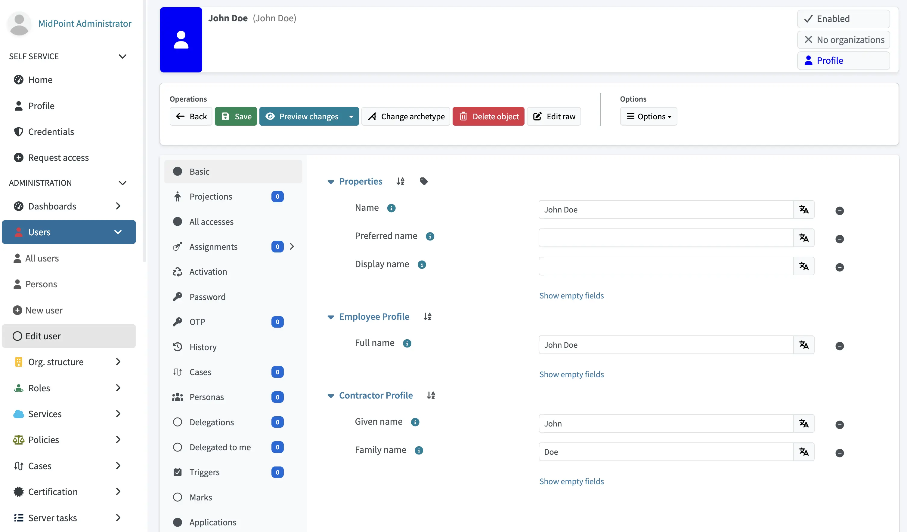

= How-to: Group attributes into profiles
:toc: top
:toclevels: 3
:experimental:
:page-description: This guide describes how to group related attributes into labelled profile sections on the midPoint Basic panel.
:page-keywords: midPoint, schema, extension, complex type, container, archetype, profile, attribute grouping

This guide describes how to group related attributes into labelled profile sections on the midPoint User *Basic* panel.

While this guide focuses on the User object, the same approach can be applied to any object type that has a `formPanel` type panel.
This means that you can group attributes in panels also for Roles, Organizations, and other objects.

== Introduction

As identity models grow, the base User object accumulates dozens of loosely related attributes. Presenting them as one long, flat list on the *Basic* panel makes the form hard to read and hard to maintain. A common requirement — especially for persona-based or multi-affiliation deployments — is to group related attributes into clearly labelled *profile sections*, such as an *Employee Profile* and a *Contractor Profile*.

.Example grouping of attributes into labelled profile sections on the Basic panel

There are two distinct ways to achieve this, and they solve fundamentally different problems:

* *Option A — Archetype.* A pure presentation layer. You define virtual containers in the archetype's `adminGuiConfiguration` that group attributes the User object already has (standard or flat extension attributes) under collapsible, labelled headings on the *Basic* panel. The data model is untouched. +
Use this option if you only need to organize existing attributes.
* *Option B — Extension schema (experimental).* A data-model change. You define `xsd:complexType` profiles and embed them as `<a:container/>` elements on `UserExtensionType`, creating genuinely new, repeatable, structured sub-objects. +
Use this if you need to model new structured data.

== Prerequisites

* A running midPoint instance
* Administrative privileges sufficient to modify:
** Archetypes (for <<option-a,Option A - Archetype>>)
** `systemConfiguration`
** Schema directory (for <<option-b,Option B - Extension schema>>)
* Basic familiarity with XML; for Option B, familiarity with XSD (XML Schema Definition) syntax

== Configuration overview

[%autowidth]
|===
| Option | Mechanism | Best suited for | Attribute searchability

| A — Archetype
| Virtual containers in the `basic` panel via `adminGuiConfiguration`.
| Grouping existing standard or flat extension attributes into labelled sections without changing the data model.
| Preserved — attributes remain regular, indexed properties.

| B — Extension schema
| Embedded `xsd:complexType` containers on `UserExtensionType`.
| Modelling genuinely new, structured, repeatable sub-objects (multi-affiliation contracts, etc.).
| Limited — Option B is <<experimental-warning,experimental>>.
|===

[[option-a]]
== Option A — Archetype

This approach overrides the layout of the *Basic* panel for any User that carries the archetype.
You declare one virtual `container` per profile section, give it a label and a display order, and list the attribute paths that belong to it.
Because the referenced attributes are still ordinary properties, they keep their indexing and stay usable in search and filter options.

Proceed as follows:

. Navigate to +++<i class="fe fe-archetype_smooth"></i>+++ btn:[Archetypes] > +++<i class="fe fe-archetype_smooth"></i>+++ btn:[All archetypes].
. Open the archetype that is assigned to user objects for which you want to group attributes.
. Click [.nowrap]#icon:edit[] btn:[Edit raw]# and add the following virtual-container layout to the archetype:
+
[source,xml]
----
<adminGuiConfiguration>
    <objectDetails>
        <type>c:UserType</type>
        <panel>
            <identifier>basic</identifier>
            <container>
                <identifier>employeeProfile</identifier>
                <display>
                    <label>Employee Profile</label>
                </display>
                <displayOrder>110</displayOrder>
                <item>
                    <path>fullName</path>
                </item>
                <item>
                    <path>emailAddress</path>
                </item>
            </container>
            <container>
                <identifier>contractorProfile</identifier>
                <display>
                    <label>Contractor Profile</label>
                </display>
                <displayOrder>120</displayOrder>
                <item>
                    <path>givenName</path>
                </item>
                <item>
                    <path>familyName</path>
                </item>
            </container>
        </panel>
    </objectDetails>
</adminGuiConfiguration>
----

+
See the full <<example-archetype,archetype example below>>.

. Click [.nowrap]#icon:save[] btn:[Save]# to save the changes.

+
[TIP]
====
Alternatively, you can create a new archetype from scratch by:

. Clicking +++<i class="fe fe-archetype_smooth"></i>+++ btn:[Archetypes] > +++<i class="fe fe-archetype_smooth"></i>+++ btn:[New archetype].
. Configuring some basic attributes:
    ** On the [.nowrap]#icon:circle[] btn:[Basic]# tab, make sure the archetype has a *Name* (for example, `PersonaProfileLayout`).
    ** On the [.nowrap]#icon:circle[] btn:[Archetype policy]# tab, in the *Display* section, make sure the archetype has the *Label*, *Plural label*, and *Icon* set.
. Adding the `adminGuiConfiguration` block as shown above, and then assigning the archetype to objects such as Users (either directly, through an object template, or during import).
====

. Go to the *Basic* panel of an object that has this archetype.
You will see dedicated *Employee Profile* and *Contractor Profile* sections, each grouping the attributes you listed.
You may need to wait a few moments or refresh the page.

[[example-archetype]]
.Example archetype XML for Option A applied to users
[source,xml]
----
<archetype
    xmlns="http://midpoint.evolveum.com/xml/ns/public/common/common-3"
    xmlns:c="http://midpoint.evolveum.com/xml/ns/public/common/common-3"
           oid="11111111-1111-1111-1111-111111110001">
    <name>PersonaProfileLayout</name>
    <assignment id="1">
        <identifier>holderType</identifier>
        <activation>
            <effectiveStatus>enabled</effectiveStatus>
        </activation>
        <assignmentRelation id="2">
            <holderType>UserType</holderType>
        </assignmentRelation>
    </assignment>
    <archetypePolicy>
        <display>
            <label>Profile</label>
            <pluralLabel>Profiles</pluralLabel>
            <icon>
                <cssClass>fa fa-user</cssClass>
                <color>blue</color>
            </icon>
        </display>
        <adminGuiConfiguration>
            <objectDetails>
                <type>c:UserType</type>
                <panel>
                    <identifier>basic</identifier>
                    <container>
                        <identifier>employeeProfile</identifier>
                        <display>
                            <label>Employee Profile</label>
                        </display>
                        <displayOrder>110</displayOrder>
                        <item>
                            <path>fullName</path>
                        </item>
                        <item>
                            <path>emailAddress</path>
                        </item>
                    </container>
                    <container>
                        <identifier>contractorProfile</identifier>
                        <display>
                            <label>Contractor Profile</label>
                        </display>
                        <displayOrder>120</displayOrder>
                        <item>
                            <path>givenName</path>
                        </item>
                        <item>
                            <path>familyName</path>
                        </item>
                    </container>
                </panel>
            </objectDetails>
        </adminGuiConfiguration>
    </archetypePolicy>
</archetype>
----

[NOTE]
====
The `path` elements may point to standard User attributes (as above) or to *flat* extension attributes (for example, `extension/employeeUpn`). Either way the attribute keeps its native indexing, so grouping it here has no effect on search or filtering — this is the key advantage of Option A over Option B.
====

[[option-b]]
== Option B — Extension schema (embedded complex types)

This approach changes the data model. You define each profile as an `xsd:complexType` and then embed it on `UserExtensionType` as an `<a:container/>` element. The result is a genuinely new, structured container on the User object that can be made repeatable for multi-affiliation scenarios.

[[experimental-warning]]
[WARNING]
====
**Option B is experimental.** It has been observed that attributes living *inside* embedded child complex types lose their indexability — even when explicitly flagged with `<a:indexed>true</a:indexed>` — and cannot be reliably mapped into the *Basic* panel's filter and search options in the UI. If you need those attributes to be searchable, use <<option-a,Option A>>, or apply the flat-attribute workaround described in <<limitations,Limitations and considerations>>.
====

Three structural pieces are needed:

. **The inner profiles** — `xsd:complexType` definitions for the distinct roles (`Employee`, `Contractor`).
. **The outer container** — the `UserExtensionType` definition that extends midPoint's native `UserType`.
. **The bindings** — `xsd:element` blocks inside the outer container that reference the inner profiles and flag them as `<a:container/>`.

[[step-1]]
=== Step 1 — Define the inner complex types

Define both profiles inside the `<xsd:schema>` block. Note that the element names inside each profile are prefixed (`employee_*`, `contractor_*`) so they stay unambiguous once embedded.

==== XML approach

[source,xml]
----
<xsd:complexType name="EmployeeProfileType">
    <xsd:sequence>
        <xsd:element minOccurs="0" name="employee_upn" type="xsd:string">
            <xsd:annotation>
                <xsd:appinfo>
                    <a:displayName>UPN</a:displayName>
                    <a:displayOrder>10</a:displayOrder>
                    <a:indexed>true</a:indexed>
                </xsd:appinfo>
            </xsd:annotation>
        </xsd:element>
        <xsd:element maxOccurs="unbounded" minOccurs="0" name="employee_department" type="xsd:string">
            <xsd:annotation>
                <xsd:appinfo>
                    <a:displayName>Department</a:displayName>
                    <a:displayOrder>20</a:displayOrder>
                </xsd:appinfo>
            </xsd:annotation>
        </xsd:element>
    </xsd:sequence>
</xsd:complexType>

<xsd:complexType name="ContractorProfileType">
    <xsd:sequence>
        <xsd:element minOccurs="0" name="contractor_job_profile" type="xsd:string">
            <xsd:annotation>
                <xsd:appinfo>
                    <a:displayName>Job Profile</a:displayName>
                    <a:displayOrder>10</a:displayOrder>
                </xsd:appinfo>
            </xsd:annotation>
        </xsd:element>
    </xsd:sequence>
</xsd:complexType>
----

=== Step 2 — Embed the profiles into the User definition

Embed the inner types into `UserExtensionType` by declaring `xsd:element` tags, setting their `type` to the names defined in <<step-1,Step 1>> (`tns:EmployeeProfileType`, `tns:ContractorProfileType`), and flagging each as `<a:container/>`.

==== XML approach

[source,xml]
----
<xsd:complexType name="UserExtensionType">
    <xsd:annotation>
        <xsd:appinfo>
            <a:extension ref="c:UserType"/>
        </xsd:appinfo>
    </xsd:annotation>
    <xsd:sequence>

        <xsd:element maxOccurs="unbounded" minOccurs="0" name="employee" type="tns:EmployeeProfileType">
            <xsd:annotation>
                <xsd:appinfo>
                    <a:displayName>Employee</a:displayName>
                    <a:container/>
                </xsd:appinfo>
            </xsd:annotation>
        </xsd:element>

        <xsd:element maxOccurs="unbounded" minOccurs="0" name="contractor" type="tns:ContractorProfileType">
            <xsd:annotation>
                <xsd:appinfo>
                    <a:displayName>Contractor</a:displayName>
                    <a:container/>
                </xsd:appinfo>
            </xsd:annotation>
        </xsd:element>

        <xsd:element maxOccurs="unbounded" minOccurs="0" name="all_department" type="xsd:string">
            <xsd:annotation>
                <xsd:appinfo>
                    <a:displayName>All Departments</a:displayName>
                    <a:indexed>true</a:indexed>
                </xsd:appinfo>
            </xsd:annotation>
        </xsd:element>

    </xsd:sequence>
</xsd:complexType>
----

[NOTE]
====
Setting `maxOccurs="unbounded"` on the embedded elements is what enables the multi-affiliation requirement, allowing a single midPoint User to hold multiple concurrent employee or contractor contracts.
====

==== GUI approach

A custom extension schema is file-based and cannot be authored purely through the GUI; the GUI's role here is deployment confirmation and use of the resulting fields.

. Save the completed `.xsd` files and place them in the schema directory of your midPoint home (`<midPoint_home>/schema/`).
. Restart midPoint (or reload the schema) so the new definitions are registered.
. In the GUI, navigate to a User object. The extension area now shows dedicated, collapsible *Employee* and *Contractor* sections.

== Verification

For <<option-a,Option A>>:

. Confirm the archetype is assigned to the test User.
// how do I do that?
. Open the User and verify the *Basic* panel shows the *Employee Profile* and *Contractor Profile* sections in the order set by `displayOrder`.
. Confirm the grouped attributes remain available in the User search/filter options.

For <<option-b,Option B>>:

. Confirm the schema loaded after restart (no startup errors in the log).
. Open a User and verify the **Employee** and **Contractor** containers render in the extension area, and that adding multiple instances is possible.

[[limitations]]
== Limitations and considerations

* *Container search limitations (Option B)* - Attributes inside embedded containers cannot be reliably searched natively — even when flagged `<a:indexed>true</a:indexed>` — and may not appear among the *Basic* panel's filter options.
* *The flat-attribute workaround (Option B)* - Because of the search limitation, searchable values are often duplicated.
Syncing, for example, department values into a hidden, multi-valued *flat* attribute (such as `all_department` in Step 2) — outside any profile container — keeps them searchable within midPoint.
* *Presentation vs. data model* - <<option-a,Option A>> changes only how attributes are displayed; it adds no new storage.
If you need new, structured, repeatable data, Option A alone is not sufficient.

== Extending further

=== Sub-containers (Option B)

The container pattern can, in theory, be nested further (for example, a `ContractDetails` container inside `EmployeeProfileType`). However, UI rendering and mapping complexity increase significantly, and the search limitations compound. Prefer a single layer of encapsulation.

=== Additional personas

* *Option A* - Add another virtual `container` block with a new `identifier`, `label`, and `displayOrder`, then list its `item` paths.
* *Option B* - Define an additional `xsd:complexType` (for example, `GuestProfileType`) and embed it on `UserExtensionType` using the same structural pattern.

== Related topics

* xref:/midpoint/reference/schema/custom-schema-extension/[]
* xref:/midpoint/reference/schema/data-model-essentials/[]
* xref:/midpoint/reference/admin-gui/admin-gui-config/[]
* xref:/midpoint/reference/schema/archetypes/[]
