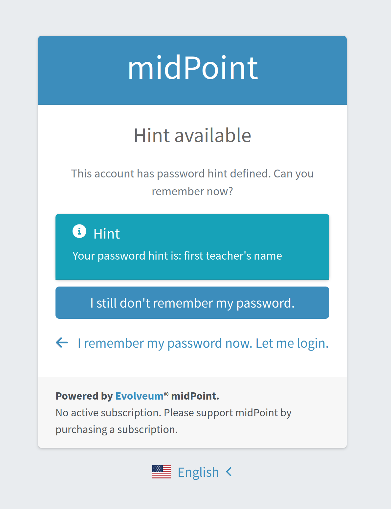

= Password hint
:page-toc: top
:page-upkeep-status: green
:page-description: This describes how to implement hints for passwords.
:page-keywords: password reset, reset password, forgotten password, credentials reset, self-service, password hint, hint
:experimental:

This describes how to implement hints for passwords.

== Introduction

Password hints are a way to help users remember their passwords without revealing the password itself.
They can be used as part of a password reset process or as a reminder for users who have forgotten their passwords.

While useful, using hints may not always be the best choice for security reasons. Hints can sometimes give away too much information about the password, making it easier for attackers to guess it. Therefore, it's important to carefully consider the design and implementation of password hints.

When implementing password hints, consider the following best practices:

* Make sure the hint is not too obvious or easily guessable.
* Avoid using personal information that could be easily obtained by others.
* Encourage users to create hints that are meaningful to them but not easily associated with their password.

== Implementation

Hints can be implemented as part of the xref:/midpoint/reference/security/credentials/password-reset/[password reset process] on which this section is based.
Refer to that page for the overall password reset process and its configuration in the security policy.

For illustrative purposes, we will consider the following password reset process, in which we will focus on the password hint part:

. After requesting the password reset, the user has to enter their user name.
. If the user name is correct and there is a password hint for that user, the hint is shown.
. If the hint does not help the user recall the password, an email with a password reset link is sent to them.

Hints have to be configured in the security policy, both in the `modules` and in the `sequence` sections.

.Example security policy configuration
[source,xml]
----
<securityPolicy xmlns="http://midpoint.evolveum.com/xml/ns/public/common/common-3"
                oid="00000000-0000-0000-0000-000000000120">
    <name>Default Security Policy</name>
    <authentication>
        <modules>
            <!-- default modules (loginForm and so on) are not shown here -->
            <mailNonce> <!--3-->
                ...
            </mailNonce>
            <focusIdentification> <!--1-->
                ...
            </focusIdentification>
            <hint> <!--2-->
                <identifier>passwordHint</identifier>
            </hint>
        </modules>
        <!-- default sequences (admin-gui-default and so on) are not shown here -->
        <sequence>
            <identifier>password-reset</identifier>
            <channel>
                <channelId>http://midpoint.evolveum.com/xml/ns/public/common/channels-3#resetPassword</channelId>
                <urlSuffix>resetPassword</urlSuffix>
            </channel>
            <module> <!--1-->
                <identifier>userName</identifier>
                <order>10</order>
                <necessity>requisite</necessity>
            </module>
            <module> <!--2-->
                <identifier>passwordHint</identifier>
                <order>20</order>
                <necessity>optional</necessity>
                <acceptEmpty>true</acceptEmpty>
            </module>
            <module> <!--3-->
                <identifier>mailNonce</identifier>
                <order>30</order>
                <necessity>required</necessity>
            </module>
        </sequence>
        <!-- ... -->
    </authentication>
    <credentials>
        <!-- definition for password credentials is not shown here -->
        <nonce> <!--3-->
            ...
        </nonce>
    </credentials>
    <credentialsReset> <!--4-->
        <identifier>global-credentials-reset</identifier>
        <authenticationSequenceName>password-reset</authenticationSequenceName>
    </credentialsReset>
</securityPolicy>
----
<1> This module is used to identify which user is going to reset their password.
It has a definition in the `modules` section and a use in the `password-reset` sequence.
<2> This module provides a password hint (if present).
Again, it has a definition in `modules` and a use in the sequence. +
This gives users the chance to recall their password without needing to reset it.
<3> This module defines an authentication using a nonce that is sent to the user via email.
It is defined in `modules`, in the sequence, and finally - because nonce is a type of credentials - also in the `credentials` section.
The nonce credential definition tells midPoint e.g. about the time validity for the link, lock-out strategy, and optionally a value generation configuration.
<4> Finally, the `credentialsReset` enables the "password reset" feature, and designates `password-reset` as the sequence of steps that should be applied.

The second module in our example is named `passwordHint` and is of the xref:/midpoint/reference/security/authentication/flexible-authentication/modules/hint[`hint` type].
The goal here is to show a password hint to the user, if such a hint is defined.
The behavior in the case of missing hint is driven by the `acceptEmpty` property.
As in our example it is set to `true`, this step is skipped for the users that have no hint defined.

If the hint is present, it is shown to the user.
After that, the user has two options.
Either they remember their password and continue with standard login, or they still don't remember the password and can continue with the reset password flow.
The hint module is shown in Figure 3.

.The hint module

If the user decides to continue because, even after the hint was shown, they couldn't remember their password, they will be redirected to the `mailNonce` module.